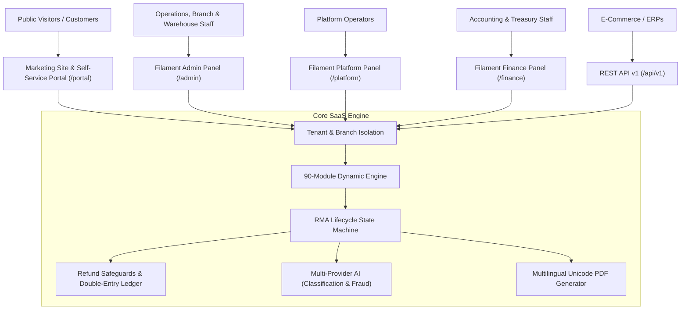

# Returns & Refund Manager — Complete RMA Business SaaS

[](https://php.net)
[](https://laravel.com)
[](https://filamentphp.com)
[](LICENSE)

An enterprise-grade, multi-tenant, AI-powered Returns Merchandise Authorization (RMA), reverse logistics, warranty claims, diagnostics repair, and financial refund management SaaS platform.

Designed to serve businesses ranging from single retail storefronts to international omnichannel enterprises processing millions of returns annually.

---

## 🏛 Architecture Diagram



---

## 🚀 Key Highlights & Capabilities

- **Strict Multi-Tenancy**: Complete backend query and data isolation using `TenantScope` and `BelongsToTenant`.
- **Hierarchical Multi-Branch**: Legal Entity -> Region -> Physical Branch -> Warehouse bin hierarchy supporting **Buy-Online-Return-In-Store (BORIS)**.
- **90-Module Capability Catalog**: Toggled per tenant through a live administrative interface without downtime or data destruction.
- **RMA Lifecycle State Machine**: Full lifecycle orchestration: `pending_review` ➔ `approved` ➔ `label_generated` ➔ `item_shipped` ➔ `item_received` ➔ `inspecting` ➔ `inspection_completed` ➔ `refund_processing` ➔ `refunded` ➔ `closed`.
- **Financial Refund Engine**:
  - Remaining refundable balance verification (blocks over-refunding).
  - Distributed idempotency locks (prevents double payouts).
  - Automated balanced double-entry financial journals.
  - Digital store credit wallet balances.
- **Diagnostics & Warranty Center**: Serial number traceability, diagnostic checklists, technician labor billing, and spare parts inventory.
- **AI-Powered Intelligence**:
  - Unstructured return reason classification.
  - Multidimensional fraud and abuse risk scoring (0–100).
  - Grounded customer policy support assistant (RAG).
  - Resilient automatic heuristic fallback when AI API keys are not supplied.
- **Internationalized Unicode Documents**:
  - Courier return shipping labels with tracking barcodes.
  - In-store drop-off vouchers.
  - Multilingual tax credit notes in English, Bengali, and Arabic.
- **3 Dedicated Filament Administrative Panels**:
  - Operations Admin Panel (`/admin`)
  - Platform Super Admin Panel (`/platform`)
  - Financial & Ledger Panel (`/finance`)
- **Customer Self-Service Portal (`/portal`)**:
  - Order review and multi-item return submission wizard.
  - Printable labels and drop-off vouchers.
  - Dispute arbitration appeals and in-app messaging.
  - Guest Order Lookup (`/portal/guest-lookup`).
- **Interactive Sandbox Showcase (`/demo`)**: 1-click role logins and real-time step-by-step RMA state progression runner.

---

## 🛠 Technology Stack

- **Framework**: Laravel 13.x
- **Language**: PHP 8.5.4 (Constructor Promotion, Type Hints, Enums)
- **Admin Framework**: Filament v5.11
- **UI & Styling**: Livewire, Tailwind CSS, Alpine.js, Blade, Vite
- **Database**: SQLite (Local Dev / CI), MySQL 8.0+ / PostgreSQL (Production)
- **Cache & Queues**: Redis 7
- **Authentication**: Laravel Session & Laravel Sanctum Bearer Tokens
- **Integrated Packages**:
  - `imrandevbd/laravel-ai-hub` (Multi-provider AI)
  - `imrandevbd/laravel-unicode-pdf` (Multilingual PDF generation)
  - `imrandevbd/laravel-universal-slug` (Multilingual internationalized slugs)
  - `imrandevbd/laravel-ai-catalog` (Product intelligence & enrichment)

---

## 📦 Quick Installation

### Prerequisites
- PHP 8.2+ (PHP 8.4+ recommended, tested on PHP 8.5.4)
- Composer 2.2+
- Node.js 20+ and npm

### Local Setup
```bash
# 1. Clone repository
git clone https://github.com/imrandevbd/returns-and-refund-manager-rma-workflow.git
cd returns-and-refund-manager-rma-workflow

# 2. Configure environment
cp .env.example .env
php artisan key:generate

# 3. Install dependencies
composer install
npm install
npm run build

# 4. Migrate database & seed demonstration data
php artisan migrate:fresh --seed

# 5. Start local server
php artisan serve
```
Visit `http://localhost:8000` in your web browser.

---

## 🐳 Docker Deployment

The application includes a production-ready multi-stage `Dockerfile` and `docker-compose.yml`:

```bash
# Build and run containers
docker compose up -d --build

# Run migrations and seed data inside container
docker compose exec app php artisan migrate --force
docker compose exec app php artisan db:seed --force
```

Services exposed:
- **Web / Application**: `http://localhost:8080`
- **MySQL Database**: `3306`
- **Redis Cache & Queues**: `6379`
- **Background Worker**: `rma_queue_worker`
- **Scheduler Daemon**: `rma_scheduler`

---

## 🔑 Pre-Seeded Demonstration Accounts

All accounts share the default password: **`password`**

| Role | Email | Target Interface | Purpose |
|---|---|---|---|
| **Platform Super Admin** | `superadmin@demo.example` | `/platform` | Global tenant management, SaaS plans, global audit logs |
| **RetailSphere Tenant Owner** | `owner@retailsphere.demo.example` | `/admin` | Tenant company settings, branch config, module management |
| **Dhaka Branch Manager** | `manager@retailsphere.demo.example` | `/admin` | Branch returns queue, manager approvals |
| **RetailSphere Finance Manager** | `finance@retailsphere.demo.example` | `/finance` | Payment gateway refunds, credit notes, financial journals |
| **Warehouse Inspector** | `inspector@retailsphere.demo.example` | `/admin` | Barcode scan intake, condition grading (Grade A/B/C/Defective) |
| **Customer Demo Account** | `customer@retailsphere.demo.example` | `/portal` | Customer self-service returns, label printing, messaging |
| **TechCare Electronics Admin** | `admin@techcare.demo.example` | `/admin` | Service center repairs, diagnostics, spare parts |
| **GlobalReturns 3PL Admin** | `admin@globalreturns.demo.example` | `/admin` | 3PL multi-client reverse logistics, pallet intake |

---

## 🧩 90-Module Capability Engine Summary

Modules are grouped into 8 operational categories and can be toggled on/off on `/admin/modules`:

1. **Core Operations (1–15)**: `rma_core`, `return_policy`, `auto_approval`, `dispute_management`, `customer_messaging`, `sla_tracking`, `multi_item_split`, `attachment_manager`, `barcode_intake`, `drop_off_locator`, `guest_returns`, `return_reasons`, `status_webhooks`, `bulk_rma_import`, `centralized_auditing`.
2. **Financial Operations (16–30)**: `refunds`, `financial_ledger`, `credit_notes`, `store_credit`, `restocking_fees`, `tax_reversals`, `shipping_fee_refunds`, `partial_refund_engine`, `multi_currency_refunds`, `payment_gateway_fallback`, `bank_transfer_payouts`, `idempotent_payout_guard`, `accounting_reconciliation`, `gift_card_refunds`, `financial_export_erps`.
3. **Inventory & Warehouse (31–45)**: `inspection`, `disposition`, `quarantine_management`, `refurbishment_pipeline`, `liquidation_b2b`, `scrap_writeoff`, `rts_return_to_supplier`, `warehouse_zones`, `cross_dock_returns`, `serial_tracking`, `batch_lot_tracking`, `inventory_reservation`, `multi_warehouse_routing`, `shrinkage_audit`, `rfid_scan_intake`.
4. **After-Sales & Warranty (46–55)**: `warranty`, `repairs`, `spare_parts`, `exchanges`, `replacements`, `technician_dispatch`, `recall_management`, `diagnostic_checklists`, `warranty_certificate_gen`, `repair_labor_costing`.
5. **Logistics & Courier (56–65)**: `reverse_logistics`, `courier_pathao`, `courier_redx`, `courier_steadfast`, `carrier_fedex_ups`, `pickup_scheduler`, `paperless_qr_label`, `freight_returns`, `customs_cross_border`, `realtime_tracking_webhooks`.
6. **AI & Automation (66–75)**: `ai_intelligence`, `ai_fraud_scoring`, `ai_customer_assistant`, `ai_defect_vision`, `ai_sentiment_analysis`, `ai_catalog_enrichment`, `predictive_return_rates`, `ai_provider_failover`, `workflow_automation`, `smart_disposition_ai`.
7. **Enterprise & Compliance (76–85)**: `multi_tenancy`, `multi_branch`, `cross_branch_returns`, `rbac_permissions`, `gdpr_privacy`, `soc2_audit_trail`, `sso_saml_oauth`, `customer_portal`, `attendance_workforce`, `tenant_billing_metering`.
8. **Industry-Specific Capabilities (86–90)**: `apparel_fashion_sizing`, `electronics_imei_lock`, `perishable_grocery_rma`, `furniture_white_glove`, `b2b_wholesale_rma`.

*Detailed descriptions available in [docs/modules.md](file:///home/imran/project/returns-and-refund-manager-rma-workflow/docs/modules.md).*

---

## 🧪 Testing Suite

Automated test suite covers tenancy boundaries, state machines, financial guarantees, and APIs:

```bash
# Run the complete test suite
php artisan test
```

### Test Coverage Highlights
- **`TenancyIsolationTest`**: Verifies Tenant A cannot access Tenant B's RMAs or orders.
- **`RmaWorkflowTest`**: Validates eligibility, auto-approval thresholds, lifecycle state machine, and PDF document generation.
- **`RefundSafetyEngineTest`**: Asserts remaining balance enforcement, duplicate payout protection via idempotency, balanced journal lines, and digital wallets.
- **`ModuleManagementTest`**: Asserts catalog integrity of all 90 modules and non-destructive safe disabling.
- **`PublicAndPortalWorkflowTest`**: Asserts all 9 public marketing pages, guest RMA lookups, and interactive demo step advance.
- **`RmaApiTest`**: Validates REST API v1 endpoints for RMA listing, creation, and module querying.

---

## 📚 Detailed Documentation Directory

Complete architectural guides are located in the [`docs/`](file:///home/imran/project/returns-and-refund-manager-rma-workflow/docs/) directory:

- [System Architecture](file:///home/imran/project/returns-and-refund-manager-rma-workflow/docs/architecture.md)
- [Installation Guide](file:///home/imran/project/returns-and-refund-manager-rma-workflow/docs/installation.md)
- [Deployment Guide](file:///home/imran/project/returns-and-refund-manager-rma-workflow/docs/deployment.md)
- [Configuration Reference](file:///home/imran/project/returns-and-refund-manager-rma-workflow/docs/configuration.md)
- [Multi-Tenancy Guide](file:///home/imran/project/returns-and-refund-manager-rma-workflow/docs/tenancy.md)
- [Multi-Branch (BORIS) Architecture](file:///home/imran/project/returns-and-refund-manager-rma-workflow/docs/branches.md)
- [90-Module Capability Engine](file:///home/imran/project/returns-and-refund-manager-rma-workflow/docs/modules.md)
- [Roles & Permissions](file:///home/imran/project/returns-and-refund-manager-rma-workflow/docs/permissions.md)
- [RMA Workflow & State Machine](file:///home/imran/project/returns-and-refund-manager-rma-workflow/docs/rma-workflow.md)
- [Refund Engine & Financial Ledger](file:///home/imran/project/returns-and-refund-manager-rma-workflow/docs/refunds.md)
- [Warehouse Intake & Disposition](file:///home/imran/project/returns-and-refund-manager-rma-workflow/docs/inventory.md)
- [Warranty & Diagnostics Repairs](file:///home/imran/project/returns-and-refund-manager-rma-workflow/docs/warranty.md)
- [External Integrations](file:///home/imran/project/returns-and-refund-manager-rma-workflow/docs/integrations.md)
- [AI & Predictive Returns](file:///home/imran/project/returns-and-refund-manager-rma-workflow/docs/ai-features.md)
- [Public Website & Sandbox Demo](file:///home/imran/project/returns-and-refund-manager-rma-workflow/docs/public-website.md)
- [REST API v1 Reference](file:///home/imran/project/returns-and-refund-manager-rma-workflow/docs/api.md)
- [Webhooks & Events](file:///home/imran/project/returns-and-refund-manager-rma-workflow/docs/webhooks.md)
- [Security & Audit Integrity](file:///home/imran/project/returns-and-refund-manager-rma-workflow/docs/security.md)
- [GDPR & CCPA Privacy Compliance](file:///home/imran/project/returns-and-refund-manager-rma-workflow/docs/privacy.md)
- [Performance & Optimization](file:///home/imran/project/returns-and-refund-manager-rma-workflow/docs/performance.md)
- [Automated Testing Guide](file:///home/imran/project/returns-and-refund-manager-rma-workflow/docs/testing.md)
- [Interactive Demo Guide](file:///home/imran/project/returns-and-refund-manager-rma-workflow/docs/demo-guide.md)
- [Troubleshooting & Diagnostics](file:///home/imran/project/returns-and-refund-manager-rma-workflow/docs/troubleshooting.md)
- [Operations Runbook](file:///home/imran/project/returns-and-refund-manager-rma-workflow/docs/operations-runbook.md)
- [Disaster Recovery Plan](file:///home/imran/project/returns-and-refund-manager-rma-workflow/docs/disaster-recovery.md)
- [Feature Matrix by Tier](file:///home/imran/project/returns-and-refund-manager-rma-workflow/docs/feature-matrix.md)
- [Implementation Status Checklist](file:///home/imran/project/returns-and-refund-manager-rma-workflow/docs/implementation-status.md)

---

## 👨‍💻 Developer & Author

- **Lead Developer**: Imran Ahmed
- **Email**: [me@imrandev.bd](mailto:me@imrandev.bd)
- **Website**: [https://imrandev.bd](https://imrandev.bd)

---

## 📄 License

The Returns & Refund Manager platform is open-sourced software licensed under the [MIT License](LICENSE).
