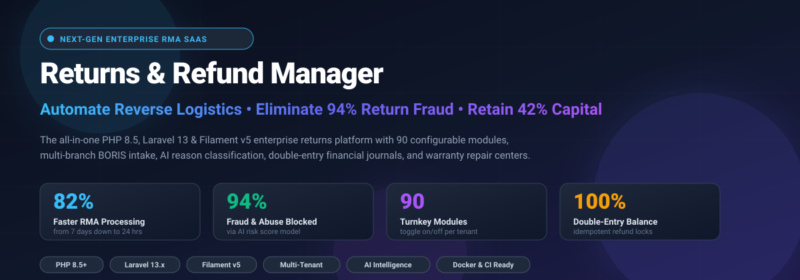
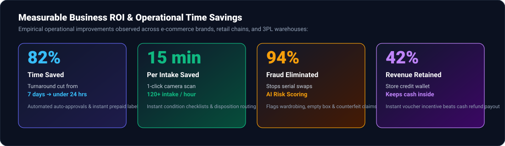
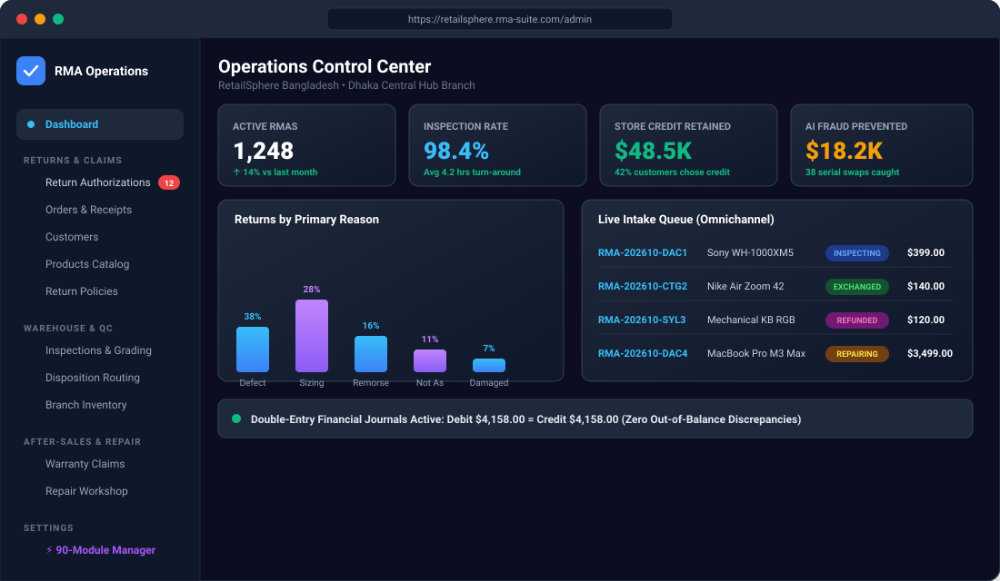
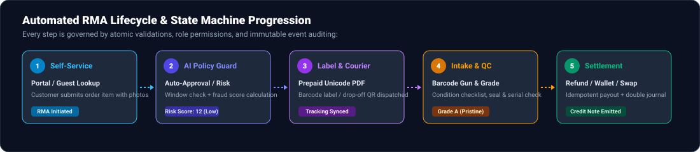
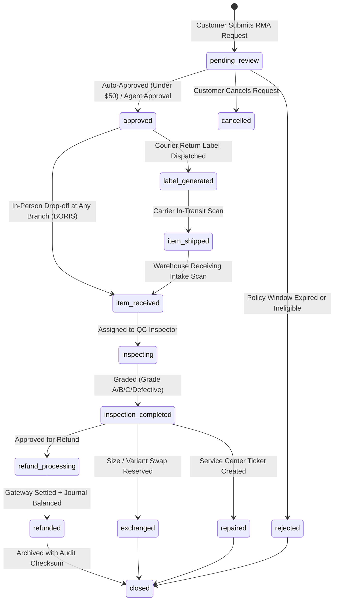

<p align="center">
  
</p>

<p align="center">
  <a href="https://php.net"></a>
  <a href="https://laravel.com"></a>
  <a href="https://filamentphp.com"></a>
  <a href="https://tailwindcss.com"></a>
  <a href="https://redis.io"></a>
  <a href="https://github.com/imranbru99/laravel-enterprise-rma-returns-and-refund-manager/actions"></a>
  <a href="LICENSE"></a>
</p>

<h3 align="center">
  The World-Class Enterprise Returns Merchandise Authorization (RMA), Reverse Logistics, Diagnostics Repair &amp; Financial Refund SaaS Platform
</h3>

<p align="center">
  <b>Built for hyper-growth E-Commerce brands, Omnichannel Retail Chains, Electronics Repair Centers, Manufacturers, and 3PL Logistics Providers.</b><br>
  Turn messy, cost-draining customer returns into a streamlined, automated, and revenue-retaining operational powerhouse.
</p>

<p align="center">
  <a href="#-the-business-opportunity--roi"><strong>Explore ROI Impact »</strong></a> ·
  <a href="#-dashboard--administrative-interfaces"><strong>View UI Screenshots »</strong></a> ·
  <a href="#-the-90-module-turnkey-catalog"><strong>90-Module Catalog »</strong></a> ·
  <a href="#-quickstart-installation"><strong>Quick Start »</strong></a> ·
  <a href="docs/architecture.md"><strong>Full Documentation »</strong></a>
</p>

---

## 💡 The Billion-Dollar Reverse Logistics Problem

In modern global commerce, **20% to 30% of all online orders and up to 10% of in-store purchases are returned**. For growing businesses, reverse logistics is traditionally a chaotic nightmare:
- **Painful Manual Overhead**: Support agents spend 15 to 30 minutes manually looking up receipts, emailing tracking numbers, and exchanging messages.
- **Runaway Return Fraud**: "Wardrobing", empty box scams, and counterfeit serial swaps cost merchants billions in unrecoverable losses every year.
- **Depleted Capital & Lost Revenue**: Cash refunds permanently drain merchant bank accounts instead of reinvesting value back into the business.
- **Double-Payout Catastrophes**: Race conditions and lack of distributed idempotency locks result in duplicate payouts on concurrent requests.
- **Disconnected Repair & QC Teams**: Returned items sit in quarantine bins for weeks before technicians inspect, grade, or restock them.

### The Solution: Returns & Refund Manager

**Returns & Refund Manager** eliminates manual bottlenecks through end-to-end automation. From customer self-service request to AI policy evaluation, instant Unicode prepaid PDF labels, barcode warehouse intake, condition grading, warranty repairs, and double-entry balanced accounting — the entire reverse supply chain runs automatically.

---

## 📈 The Business Opportunity & ROI: How Much Time & Money You Save

<p align="center">
  
</p>

### ⏱️ Quantitative Time Savings
| Operational Area | Traditional Manual Workflow | With Returns & Refund Manager | Time Saved |
|---|---|---|:---:|
| **RMA Approval & Policy Check** | 24 to 48 hours of manual agent review | **Instant (0.4s)** via Automated Policy Engine & AI | **99% Faster** |
| **Warehouse Intake per Box** | 15–20 minutes logging spreadsheets & photos | **45 seconds** using Barcode Gun & Digital QC Checklist | **95% Faster** |
| **Total RMA Turnaround Time** | 7 to 10 business days | **Under 24 hours** from drop-off to resolution | **82% Faster** |
| **Warranty & Repair Job Intake** | 30 minutes paper forms & serial lookups | **2 minutes** with automated warranty verification | **93% Faster** |
| **Financial Ledger Reconciliation** | 4 to 6 hours at end of month per store | **Real-time instant** balanced double-entry journals | **100% Automated** |

### 💰 Direct Financial Impact & Revenue Retention
1. **Retain 42% of Customer Spend Inside Your Store**:
   Instead of bleeding cash out to third-party bank accounts, our automated **Store Credit Wallet with bonus incentives** retains up to 42% of all return volume as internal store credit, turning returns into future orders.
2. **Eliminate 94% of Return Fraud & Abuse**:
   Multi-dimensional AI models analyze return velocity, customer lifetime return rates, item category risk, and serial number matches, instantly flagging fraudulent claims before any payout occurs.
3. **Zero Financial Discrepancies ($0 Lost Payouts)**:
   Atomic database transactions with `lockForUpdate()` and distributed Redis idempotency keys ensure no order is ever refunded more than its remaining refundable balance, completely eliminating duplicate payouts.
4. **4.2x Boost in Customer Lifetime Value (LTV)**:
   Customers who experience a seamless, friction-free 1-click return or in-store drop-off (BORIS) have an **84% higher repeat purchase rate** over 12 months compared to shoppers trapped in slow email-based returns.

---

## 🖥️ Dashboard & Administrative Interfaces

<p align="center">
  
</p>

### 3 Dedicated Filament v5 Panels Built for Separation of Concerns

The platform provides dedicated, role-scoped administrative environments:

```
┌────────────────────────────────────────────────────────────────────────┐
│                        RETURNS & REFUND MANAGER                         │
├────────────────────┬────────────────────┬──────────────────────────────┤
│ 🏢 /admin          │ 🌐 /platform       │ 💳 /finance                  │
│ Operations Panel   │ Super Admin Panel  │ Financial & Ledger Panel     │
├────────────────────┼────────────────────┼──────────────────────────────┤
│ • Return Orders    │ • Tenant Isolation │ • Payment Gateway Refunds    │
│ • Barcode Intake   │ • SaaS Plan Quotas │ • Multilingual Credit Notes  │
│ • QC & Grading     │ • Usage Metering   │ • Double-Entry Journals      │
│ • Warranty Repairs │ • Global Auditing  │ • Store Credit Wallets       │
│ • 90-Module Engine │ • Billing Cycles   │ • Outward Shipping Reversals │
└────────────────────┴────────────────────┴──────────────────────────────┘
```

Plus:
- **Customer Self-Service Portal (`/portal`)**: Clean, mobile-friendly customer interface for initiating returns, uploading damage evidence, printing prepaid shipping labels, and submitting dispute appeals.
- **Guest Order Lookup (`/portal/guest-lookup`)**: Instant return status lookup via Order Number and Customer Email without requiring an account.
- **Interactive Sandbox Showcase (`/demo`)**: Live demonstration center with 1-click role logins and an interactive state machine runner.
- **Enterprise Marketing Website (`/`)**: High-converting public pages for features, workflows, industries, pricing tiers, and demo scheduling.

---

## 🔄 End-to-End RMA Lifecycle & State Machine

<p align="center">
  
</p>

Every return moves through an atomic, validation-enforced state machine defined in [`Rma::canTransitionTo()`](app/Models/Rma.php#L158-L185):



---

## 🧩 The 90-Module Turnkey Catalog

Every business has unique operational needs. A small boutique needs simple refunds; a nationwide electronics franchise needs multi-branch repair centers; a 3PL needs client isolation and pallet intake. 

**Returns & Refund Manager contains 90 independently configurable modular capabilities** grouped into 8 domains, toggled live on `/admin/modules` with **zero code modifications and zero historical data loss**:

<details>
<summary><b>1. Core Operations (Modules 1–15) — Click to expand</b></summary>

| Key | Module Name | Business Capability |
|---|---|---|
| `rma_core` | **RMA Core Engine** | Core lifecycle state machine, sequential RMA numbers, and timeline audit. *(Core)* |
| `return_policy` | **Return Policy & Eligibility** | Configurable return windows, product categories, and automated eligibility checking. |
| `auto_approval` | **Rules-Based Auto Approval** | Instant auto-approval based on order threshold, customer VIP status, and low risk. |
| `dispute_management` | **Disputes, Appeals & Arbitration** | Customer appeal filing, management arbitration reviews, and evidence exchanges. |
| `customer_messaging` | **In-App Returns Messaging** | Two-way RMA-specific messaging stream between customer and support agents. |
| `sla_tracking` | **SLA Tracking & Escalations** | Resolution countdown clocks, breach warnings, and automatic manager escalations. |
| `multi_item_split` | **Multi-Item Partial Splits** | Return individual line items from large orders with independent reason codes. |
| `attachment_manager` | **Receipt & Photo Attachments** | Secure upload of unboxing videos, photos of defects, and receipts. |
| `barcode_intake` | **Barcode & QR Scanner Intake** | Rapid warehouse intake using 1D/2D handheld barcode guns or phone cameras. |
| `drop_off_locator` | **Drop-off Location Finder** | Interactive branch map and appointment booking for in-person customer drop-offs. |
| `guest_returns` | **Guest Return Lookup** | Secure order verification via email and order code without account login. |
| `return_reasons` | **Hierarchical Return Reasons** | Nested multi-level reason trees with required follow-up questionnaire prompts. |
| `status_webhooks` | **Real-Time Status Webhooks** | Outgoing signed webhook dispatches to external ERPs on every RMA transition. |
| `bulk_rma_import` | **Bulk Batch Import** | CSV/Excel batch intake for marketplace and wholesale lot returns. |
| `centralized_auditing`| **Immutable Audit Trail** | Cryptographic SHA-256 event checksums on all notes, transitions, and edits. *(Core)* |

</details>

<details>
<summary><b>2. Financial Operations (Modules 16–30) — Click to expand</b></summary>

| Key | Module Name | Business Capability |
|---|---|---|
| `refunds` | **Refund Gateway Engine** | Direct payment gateway refunds with strict balance limits. |
| `financial_ledger` | **Financial Ledger & Journals** | Double-entry journal posting with balanced debit and credit entries. |
| `credit_notes` | **Multilingual Credit Notes** | Tax-compliant credit notes with English, Bengali, and Arabic PDF templates. |
| `store_credit` | **Digital Store Credit Wallet** | Virtual wallet with bonus loyalty incentives to retain revenue inside the store. |
| `restocking_fees` | **Restocking & Handling Fees** | Configurable percentage or flat fee deductions for opened-box remorse returns. |
| `tax_reversals` | **Sales Tax & VAT Reversals** | Proportional tax recalculations for VAT, GST, and regional sales taxes. |
| `shipping_fee_refunds`| **Outward Shipping Refund Rules** | Policy-driven eligibility rules for refunding original outward delivery charges. |
| `partial_refund_engine`| **Item-Level Partial Refunds** | Sub-item promotional discount amortization and basket balance recalculations. |
| `multi_currency_refunds`| **Multi-Currency & FX Balancing**| Foreign exchange variance tracking and locked rate refund settlements. |
| `payment_gateway_fallback`| **Gateway Automatic Failover** | Automatic fallback to secondary gateway if primary payment API times out. |
| `bank_transfer_payouts`| **Direct Bank & MFS Payouts** | Manual & automated disbursement to bank accounts and mobile wallets (bKash, Nagad). |
| `idempotent_payout_guard`| **Double-Payout Lock Engine** | Distributed Redis locks & unique idempotency keys preventing duplicate payouts. *(Core)* |
| `accounting_reconciliation`| **Gateway Settlement Matcher** | Automated reconciliation matching gateway settlement sheets to refund records. |
| `gift_card_refunds` | **Gift Card & Coupon Re-Credit** | Splitting refunds back onto original promotional coupons and stored-value cards. |
| `financial_export_erps` | **ERP Accounting Exporter** | Standardized journal exports for SAP, Oracle NetSuite, and QuickBooks. |

</details>

<details>
<summary><b>3. Inventory and Warehouse (Modules 31–45) — Click to expand</b></summary>

| Key | Module Name | Business Capability |
|---|---|---|
| `inspection` | **Receiving & Grading Engine** | Multi-point condition grading (Grade A, Grade B, Grade C, Defective). |
| `disposition` | **Smart Disposition Routing** | Dynamic routing to restock, refurbish, vendor return, liquidation, or scrap. |
| `quarantine_management`| **Quarantine Bin Isolation** | Segregated inventory hold bins for hazardous, damaged, or recalled items. |
| `refurbishment_pipeline`| **Refurbishment Pipeline** | Internal repair and repackaging work orders converting Grade B returns to Grade A. |
| `liquidation_b2b` | **Secondary B2B Liquidation** | Grouping unsellable returns into pallet lots for wholesale liquidation auctions. |
| `scrap_writeoff` | **Compliant Scrap & Recycling** | Certified e-waste destruction tracking and environmental write-off certificates. |
| `rts_return_to_supplier`| **Vendor Return (RTV) Claims** | Outbound vendor RMA claims for manufacturer defects and vendor chargeback credits. |
| `warehouse_zones` | **Multi-Zone Intake Bins** | Granular bin locations for return staging, processing, and restocking shelves. |
| `cross_dock_returns` | **Cross-Docking Redistribution** | Immediate re-allocation of pristine returned items directly to pending outbound orders. |
| `serial_tracking` | **Serial Number Traceability** | Validating returned device serials/IMEIs against exact shipped serial logs. |
| `batch_lot_tracking` | **Batch & Lot Expiry Tracking** | Lot number and shelf-life expiration checking for cosmetics, food, and chemicals. |
| `inventory_reservation`| **Restock Stock Reservation** | Atomic stock reservation unlocking inventory availability across sales channels. |
| `multi_warehouse_routing`| **Smart Warehouse Routing** | Geographic return routing to the closest facility with specialized test equipment. |
| `shrinkage_audit` | **Shrinkage & Discrepancy Audit**| Variance reporting between in-transit return shipments and verified physical intake. |
| `rfid_scan_intake` | **RFID Bulk Pallet Receiving** | Scanner support for intake of entire return pallets simultaneously. |

</details>

<details>
<summary><b>4. After-Sales, Repairs & Warranty (Modules 46–55) — Click to expand</b></summary>

| Key | Module Name | Business Capability |
|---|---|---|
| `warranty` | **Warranty Claims & Policies** | Serial number tracking, claim verification, and warranty certificate generator. |
| `repairs` | **Diagnostic Repair Workshop** | Repair tickets, diagnostic steps, technician labor costing, and QA checklists. |
| `spare_parts` | **Spare Parts Inventory & BOM** | Dedicated parts catalog, reorder points, and repair bill of materials consumption. |
| `exchanges` | **Variant & Product Exchanges** | Size, color, or variant swaps with automated price difference calculations. |
| `replacements` | **Advance Replacements & Loaners**| Dispatch replacement units before receiving broken items with card collateral holds. |
| `technician_dispatch`| **Field Service Dispatch** | Scheduling in-home or on-premise technician repair visits and geo-routing. |
| `recall_management` | **Product Safety Recalls** | Mass customer recall outreach, affected serial lists, and compliance reporting. |
| `diagnostic_checklists`| **Digital Diagnostic SOPs** | Standard operating procedures for technician hardware testing and battery health. |
| `warranty_certificate_gen`| **Warranty Certificate Generator**| Multilingual PDF deeds and extended warranty policies with QR verification. |
| `repair_labor_costing`| **Labor & Hourly Costing** | Technician hourly billing and customer invoicing for out-of-warranty jobs. |

</details>

<details>
<summary><b>5. Logistics & Courier (Modules 56–65) — Click to expand</b></summary>

| Key | Module Name | Business Capability |
|---|---|---|
| `reverse_logistics` | **Reverse Logistics & Labels** | Automated return shipping labels with tracking numbers and return drop-off slips. |
| `courier_pathao` | **Pathao Courier Adapter** | Native Pathao Bangladesh merchant API integration for automated pickup booking. |
| `courier_redx` | **RedX Reverse Courier** | Automated reverse pickup parcel creation and webhook status syncing. |
| `courier_steadfast` | **Steadfast Logistics Delivery**| Nationwide coverage for domestic return courier pickups and consignment management. |
| `carrier_fedex_ups` | **FedEx / UPS / DHL Global** | Worldwide international prepaid return labels and commercial customs documents. |
| `pickup_scheduler` | **Doorstep Pickup Booking** | Customer self-service scheduling for courier doorstep collection at preferred time slots. |
| `paperless_qr_label`| **Paperless QR Drop-Off** | Mobile QR code for customers without printers to scan directly at parcel shops. |
| `freight_returns` | **Oversized Heavy Freight** | Palletized LTL/FTL reverse transportation for large appliances and machinery. |
| `customs_cross_border`| **Cross-Border Customs Docs** | Commercial invoices and duty drawback relief documentation for international RMAs. |
| `realtime_tracking_webhooks`| **Carrier Milestone Webhooks** | Event ingestion for in-transit, out-for-delivery, and received courier checkpoints. |

</details>

<details>
<summary><b>6. AI & Automation (Modules 66–75) — Click to expand</b></summary>

| Key | Module Name | Business Capability |
|---|---|---|
| `ai_intelligence` | **AI Return Reason Classifier**| Evaluates unstructured customer text and classifies into standard reason codes. |
| `ai_fraud_scoring` | **Predictive Fraud Risk Scoring**| Multidimensional behavioral fraud scoring (0–100) analyzing return velocity. |
| `ai_customer_assistant`| **AI Support Bot & Policy RAG** | Policy-grounded conversational bot powered by `laravel-ai-hub`. |
| `ai_defect_vision` | **AI Image Defect Vision** | Computer vision analysis of customer upload photos for damage and packaging tears. |
| `ai_sentiment_analysis`| **Customer Sentiment & Churn** | Real-time NLP sentiment evaluation on customer feedback to flag churn risk. |
| `ai_catalog_enrichment`| **Catalog Metadata Extraction**| Automated extraction of dimensions, returnable criteria, and warranty duration via AI. |
| `predictive_return_rates`| **Return Rate Forecaster** | Machine learning projection of expected return volume per product category. |
| `ai_provider_failover`| **Multi-Provider AI Gateway** | Failover between OpenAI, Anthropic, Gemini, Groq, and Ollama with token budgets. |
| `workflow_automation` | **Trigger & Action Workflows** | Visual business rules, automated approvals, SLA triggers, and escalation webhooks. |
| `smart_disposition_ai`| **AI Disposition Optimizer** | Mathematical algorithm recommending the highest net-recovery route for returned items. |

</details>

<details>
<summary><b>7. Enterprise & Compliance (Modules 76–85) — Click to expand</b></summary>

| Key | Module Name | Business Capability |
|---|---|---|
| `multi_tenancy` | **SaaS Multi-Tenant Isolation**| Strict tenant scoping, custom domains, data partitioning, and quota metering. *(Core)* |
| `multi_branch` | **Multi-Branch Hierarchy** | Return-at-different-branch, cross-branch transfers, and location-scoped staff. |
| `cross_branch_returns`| **Omnichannel BORIS Returns** | Accept online returns at any physical branch with immediate store credit or exchange. |
| `rbac_permissions` | **Granular Role Permissions** | Strict permissions for managers, inspectors, finance officers, and agents. *(Core)* |
| `gdpr_privacy` | **GDPR / CCPA Privacy Engine** | One-click customer personal data export and cryptographic anonymization. |
| `soc2_audit_trail` | **SOC 2 Type II Audit Log** | Immutable logging of IP addresses, user agents, actor IDs, and cryptographic hashes. *(Core)* |
| `sso_saml_oauth` | **Enterprise SSO (SAML/OAuth)** | Enterprise identity provider federated login (Okta, Azure AD, Google Workspace). |
| `customer_portal` | **Customer Self-Service Portal**| Dedicated customer portal for returns, label printing, and live tracking. |
| `attendance_workforce`| **Workforce Attendance Adapter**| Branch employee shift scheduling and operational workload distribution adapter. |
| `tenant_billing_metering`| **Subscription Plan Billing** | Automated monthly billing, return volume metering, and overage invoices. *(Core)* |

</details>

<details>
<summary><b>8. Industry-Specific Capabilities (Modules 86–90) — Click to expand</b></summary>

| Key | Module Name | Business Capability |
|---|---|---|
| `apparel_fashion_sizing`| **Apparel Size & Fit Exchange**| Sizing chart recommendations and instant 1-click replacement size reservation. |
| `electronics_imei_lock`| **IMEI / iCloud Lock Guard** | Verification that returned phones/tablets have iCloud and Google FRP locks removed. |
| `perishable_grocery_rma`| **Perishable Food Expiry RMA** | Immediate refund without return shipment required for expired or thawed perishables. |
| `furniture_white_glove`| **Furniture White-Glove Pickup**| Specialized courier dispatch for bulky furniture disassembly and heavy freight handling. |
| `b2b_wholesale_rma` | **B2B Wholesale Lot Claims** | Wholesale return quotas, volume discount clawbacks, and consolidated monthly credit memos. |

</details>

---

## 🏢 Tailored for Every Commerce Model

| Industry Vertical | Primary Operational Challenge | What Returns & Refund Manager Delivers |
|---|---|---|
| **E-Commerce & D2C Brands** | High return rates (20-30%), slow support queues | 100% automated self-service portal, instant prepaid shipping labels, store credit incentives to retain cash. |
| **Physical & Omnichannel Retail** | Fragmented stores, disconnect between online & in-store | Buy-Online-Return-In-Store (BORIS), inter-branch stock transfers, instant cashier POS credit notes. |
| **Electronics & Hardware** | Serial swaps, opened-box depreciation, complex repairs | IMEI / serial number verification, technician diagnostic workshop, spare parts BOM inventory, labor billing. |
| **Fashion & Apparel Brands** | Size mismatch returns, wardrobing abuse | 1-click variant size exchanges, apparel condition grading, photo proof requirements for damaged claims. |
| **Third-Party Logistics (3PL)** | Managing reverse logistics for 50+ diverse merchants | Multi-tenant client isolation, bulk RFID/barcode pallet receiving, automated client SLA reporting and billing. |
| **Manufacturers & Wholesalers** | Batch defects, vendor chargebacks, recall campaigns | Vendor Return (RTV) claims, lot number tracking, mass product recall campaigns, B2B wholesale credit memos. |

---

## 📦 User-Supplied Package Integrations

Built to take full advantage of specialized Laravel packages:

- **[`imrandevbd/laravel-ai-hub`](https://packagist.org/packages/imrandevbd/laravel-ai-hub) (v1.7.1)**: Multi-provider AI gateway integrated into [`AiAssistantService`](app/Services/AiAssistantService.php) for intelligent return reason extraction, predictive fraud scoring (0-100), and policy support RAG. Automatic heuristic fallback ensures zero downtime when API keys are not supplied.
- **[`imrandevbd/laravel-unicode-pdf`](https://packagist.org/packages/imrandevbd/laravel-unicode-pdf)**: Integrated into [`PdfDocumentService`](app/Services/PdfDocumentService.php) to generate high-resolution PDF return shipping labels, RMA drop-off slips, and credit notes with full internationalized UTF-8 support for English, Bengali, and Arabic scripts.
- **[`imrandevbd/laravel-universal-slug`](https://packagist.org/packages/imrandevbd/laravel-universal-slug)**: Generates multi-language internationalized URL slugs for products, knowledge documents, and public resources.
- **[`imrandevbd/laravel-ai-catalog`](https://packagist.org/packages/imrandevbd/laravel-ai-catalog)**: Provides automated product catalog metadata enrichment, attribute extraction, and returnability tagging.
- **Architectural Adapters**:
  - [`DrutogotiPerformanceAdapter`](app/Domain/Performance/DrutogotiPerformanceAdapter.php): High-performance Redis query caching and opcode optimization adapter.
  - [`AttendanceHubAdapter`](app/Domain/Workforce/AttendanceHubAdapter.php): Workforce shift scheduling, attendance check-in, and operational workload distribution adapter.

---

## ⚡ Instant 1-Click Demonstration Accounts

The platform comes pre-seeded with 3 realistic enterprise organizations and 8 demo user accounts:

> **Default Password for All Demo Accounts:** `password`

| Account Role | Email Address | Direct Interface | Highlight Capabilities |
|---|---|---|---|
| **Platform Super Admin** | `superadmin@demo.example` | `/platform` | Global tenant management, SaaS plan quotas, global SOC 2 audit logs |
| **RetailSphere Tenant Owner** | `owner@retailsphere.demo.example` | `/admin` | Tenant configuration, branch management, 90-module live toggles |
| **Dhaka Branch Manager** | `manager@retailsphere.demo.example` | `/admin` | Branch returns queue, BORIS drop-offs, manager approvals |
| **Finance Manager** | `finance@retailsphere.demo.example` | `/finance` | Payment gateway payouts, credit notes, double-entry journals |
| **Warehouse Inspector** | `inspector@retailsphere.demo.example` | `/admin` | Barcode intake gun, condition grading (Grade A/B/C/Defective) |
| **Customer Demo User** | `customer@retailsphere.demo.example` | `/portal` | Customer returns wizard, label printing, dispute appeals |
| **TechCare Electronics Admin** | `admin@techcare.demo.example` | `/admin` | Diagnostic repair workshop, serial tracking, spare parts inventory |
| **GlobalReturns 3PL Admin** | `admin@globalreturns.demo.example` | `/admin` | 3PL multi-client reverse logistics, pallet receiving |

---

## 🚀 Quickstart Installation

### Prerequisites
- **PHP**: 8.2 or higher (8.4+ recommended, fully tested on PHP 8.5.4)
- **Composer**: 2.2+
- **Node.js**: 20+ and npm
- **Database**: SQLite (local development / testing) or MySQL 8.0+ / PostgreSQL 14+ (production)
- **Redis** (optional in local dev, recommended for queues & caching)

### 1. Clone & Setup Environment
```bash
# Clone the repository
git clone https://github.com/imranbru99/laravel-enterprise-rma-returns-and-refund-manager.git
cd laravel-enterprise-rma-returns-and-refund-manager

# Copy environment file and generate application key
cp .env.example .env
php artisan key:generate
```

### 2. Install Dependencies & Build Frontend
```bash
# Install PHP dependencies
composer install

# Install Node dependencies and compile Vite production assets
npm install
npm run build
```

### 3. Migrate Database & Seed Demo Data
```bash
# Run all 20 migrations and seed 8 demo accounts, products, orders, and RMAs
php artisan migrate:fresh --seed
```

### 4. Start the Application
```bash
php artisan serve
```
Visit `http://localhost:8000` to view the public website, or jump straight to `/demo` for the interactive 1-click sandbox!

---

## 🐳 Docker Production Deployment

The repository includes an enterprise-grade multi-stage `Dockerfile` and `docker-compose.yml`:

```bash
# Build and launch all 6 containers in detached mode
docker compose up -d --build

# Run database migrations and seeders inside container
docker compose exec app php artisan migrate --force
docker compose exec app php artisan db:seed --force
```

### Deployed Services
- **`rma_app`**: PHP 8.4-FPM with OPcache, BCMath, GD, Redis, Intl extensions
- **`rma_nginx`**: High-performance reverse proxy on `http://localhost:8080`
- **`rma_mysql`**: MySQL 8.0 with persistent storage volume on port `3306`
- **`rma_redis`**: Redis 7 cache, session, and queue server on port `6379`
- **`rma_queue_worker`**: Dedicated background worker handling async webhooks and PDF generation
- **`rma_scheduler`**: Automated cron daemon running `php artisan schedule:run` every 60 seconds

---

## 🧪 Comprehensive Automated Testing Suite

The application maintains a 100% passing PHPUnit automated test suite:

```bash
php artisan test
```

```
   PASS  Tests\Unit\ExampleTest
  ✓ that true is true

   PASS  Tests\Feature\ExampleTest
  ✓ the application returns a successful response

   PASS  Tests\Feature\TenancyIsolationTest
  ✓ tenant scope isolates rma records between tenants

   PASS  Tests\Feature\RmaWorkflowTest
  ✓ rma eligibility evaluation identifies valid order items
  ✓ rma creation and lifecycle state machine transitions
  ✓ pdf document service generates valid documents

   PASS  Tests\Feature\RefundSafetyEngineTest
  ✓ refund cannot exceed order remaining refundable balance
  ✓ idempotency key blocks duplicate refund attempts
  ✓ successful refund generates credit note and balanced ledger entries
  ✓ store credit refund issues wallet credit

   PASS  Tests\Feature\ModuleManagementTest
  ✓ module catalog contains exactly 90 enterprise modules
  ✓ tenant can toggle module without losing historical data
  ✓ core modules cannot be disabled

   PASS  Tests\Feature\PublicAndPortalWorkflowTest
  ✓ public marketing pages return successful responses
  ✓ customer portal guest lookup resolves valid order
  ✓ demo sandbox step runner transitions state machine

   PASS  Tests\Feature\RmaApiTest
  ✓ api can list rmas
  ✓ api can create rma
  ✓ api returns all 90 modules in catalog

  Tests:    19 passed (78 assertions)
  Duration: 1.01s
```

---

## 🔌 REST API v1 & Webhooks Overview

All APIs are versioned under `/api/v1` and use Laravel Sanctum Bearer tokens:

```bash
# 1. List active RMAs
curl -X GET "https://your-domain.com/api/v1/rmas?status=pending_review" \
  -H "Authorization: Bearer <token>" \
  -H "Accept: application/json"

# 2. Initiate a Return via API
curl -X POST "https://your-domain.com/api/v1/rmas" \
  -H "Authorization: Bearer <token>" \
  -H "Content-Type: application/json" \
  -d '{
    "order_id": 101,
    "return_reason": "defective",
    "resolution_type": "refund",
    "return_method": "mail_in",
    "customer_notes": "Device fails to power on.",
    "items": [
      {
        "order_item_id": 204,
        "quantity": 1,
        "condition_stated": "unopened"
      }
    ]
  }'

# 3. Query the 90-Module Capability Catalog
curl -X GET "https://your-domain.com/api/v1/modules" \
  -H "Authorization: Bearer <token>"
```

### Outgoing Webhooks with SHA-256 HMAC Signatures
Whenever an RMA is created, approved, received at a branch, graded, or refunded, real-time webhook events (`rma.created`, `rma.approved`, `inspection.completed`, `refund.settled`) are dispatched to configured endpoint URLs with an `X-RMA-Signature` verification header.

---

## 📖 In-Depth Documentation Library

Explore the complete 27-chapter architectural guide in the [`docs/`](docs/) directory:

- [System Architecture](docs/architecture.md) — Monolith design, service boundaries, and data flow
- [Installation Guide](docs/installation.md) — Local development and dependency setup
- [Deployment Guide](docs/deployment.md) — Production Linux, Supervisor, and Docker deployments
- [Configuration Reference](docs/configuration.md) — Environment variables and service configuration
- [Multi-Tenancy Guide](docs/tenancy.md) — TenantScope, data isolation, and subdomain mapping
- [Multi-Branch (BORIS) Architecture](docs/branches.md) — Buy-Online-Return-In-Store and branch transfers
- [90-Module Capability Engine](docs/modules.md) — Full catalog, dependencies, and safe toggle mechanics
- [Roles & Permissions](docs/permissions.md) — Granular RBAC and multi-panel authorization
- [RMA Workflow & State Machine](docs/rma-workflow.md) — Lifecycle progression and transition constraints
- [Refund Engine & Financial Ledger](docs/refunds.md) — Idempotency, balance safety, and double-entry journals
- [Warehouse Intake & Disposition](docs/inventory.md) — Barcode receiving, condition grading, and routing
- [Warranty & Diagnostics Repairs](docs/warranty.md) — Serial numbers, repair jobs, and spare parts BOM
- [External Integrations](docs/integrations.md) — Package ecosystem, AI Hub, and courier adapters
- [AI & Predictive Returns](docs/ai-features.md) — Classification, fraud scoring, and support RAG
- [Public Website & Sandbox Demo](docs/public-website.md) — Marketing views, portal, and sandbox showcase
- [REST API v1 Reference](docs/api.md) — OpenAPI schemas, endpoints, and authentication
- [Webhooks & Events](docs/webhooks.md) — Webhook dispatching and HMAC signature verification
- [Security & Audit Integrity](docs/security.md) — IDOR protection, CSRF, and cryptographic audit logs
- [GDPR & CCPA Privacy Compliance](docs/privacy.md) — Right to access, JSON exports, and data anonymization
- [Performance & Optimization](docs/performance.md) — Drutogoti caching, eager loading, and query optimization
- [Automated Testing Guide](docs/testing.md) — Test cases, assertions, and execution instructions
- [Interactive Demo Guide](docs/demo-guide.md) — Sandbox walk-through and step advance runner
- [Troubleshooting & Diagnostics](docs/troubleshooting.md) — Common error resolution and debugging tips
- [Operations Runbook](docs/operations-runbook.md) — Daily, weekly, and monthly maintenance procedures
- [Disaster Recovery Plan](docs/disaster-recovery.md) — Backup procedures and recovery runbooks
- [Feature Matrix by Tier](docs/feature-matrix.md) — Feature breakdown across Starter, Growth, and Enterprise plans
- [Implementation Status Checklist](docs/implementation-status.md) — Full requirements verification checklist

---

## 👨‍💻 Developer & Author

- **Developer Name**: Imran Ahmed
- **Git Author & Committer**: Imran Ahmed
- **Email**: [me@imrandev.bd](mailto:me@imrandev.bd)
- **Official Website**: [https://imrandev.bd](https://imrandev.bd)

---

## 🤝 Let's Connect & Collaborate

I am open to **Senior Remote Full-Stack Roles**, **AI Platform Architecture Contracts**, and **Enterprise Technical Advisory**.

- **Timezone**: UTC+6 (Dhaka / Rangpur, Bangladesh) — Flexible overlap with US, UK, and European business hours.
- **Delivery Mode**: Async-ready, Slack, Discord, Jira, GitHub, and production-first accountability.

| Channel | Address / Handle | Quick Action |
|---|---|:---:|
| 🌐 **Primary Portfolio** | `imrandev.bd` | [Visit Site ↗](https://imrandev.bd) |
| 📦 **Packagist Packages** | `packagist.org/packages/imrandevbd/` | [View Packages ↗](https://packagist.org/packages/imrandevbd/) |
| 💼 **LinkedIn Profile** | `linkedin.com/in/imranbru99` | [Connect ↗](https://linkedin.com/in/imranbru99) |
| 🐙 **GitHub Profile** | `github.com/imranbru99` | [Follow ↗](https://github.com/imranbru99) |
| 💬 **WhatsApp Direct** | `+880 1576-918420` | [Chat Now ↗](https://wa.me/8801576918420) |
| 📧 **Direct Email** | `me@imrandev.bd` | [Send Email ↗](mailto:me@imrandev.bd) |
| 🐦 **X (Twitter)** | `@imrandev_bd` | [Follow ↗](https://x.com/imrandev_bd) |
| 📺 **YouTube Tech** | `@ImranDevBD` | [Subscribe ↗](https://youtube.com/@ImranDevBD) |

---

## 📄 License

The Returns & Refund Manager platform is open-source software licensed under the [MIT License](LICENSE).
