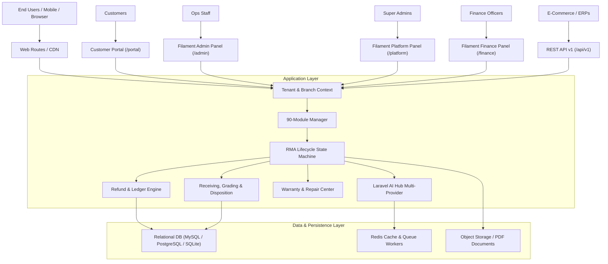

# System Architecture

## Overview
Returns & Refund Manager is built as a high-performance modular monolith using **Laravel 13** and **Filament v5** on **PHP 8.5+**. It features strict tenant isolation, a customizable 90-module capability engine, multi-branch reverse logistics, AI triage, and double-entry financial accounting.

## Modular Monolith Structure
- **Domain Services**: Encapsulated within `app/Services/` (`RmaEngineService`, `RefundEngineService`, `InventoryEngineService`, `WarrantyEngineService`, `AiAssistantService`, `PdfDocumentService`, `AuditLogService`).
- **Scoped Panels**:
  - `AdminPanelProvider` (`/admin`): Daily returns, inspections, approvals, branch inventory, and repairs.
  - `PlatformPanelProvider` (`/platform`): Multi-tenant management, SaaS plan quotas, global audit records.
  - `FinancePanelProvider` (`/finance`): Refund verification, credit note emission, double-entry journals.
- **Tenant Isolation**:
  - `App\Services\TenantContext`: Thread-safe session and request scoped tenant resolver.
  - `App\Scopes\TenantScope`: Automatically injects `tenant_id` WHERE clauses into Eloquent queries.
  - `App\Traits\BelongsToTenant`: Attaches global tenant scope and auto-populates `tenant_id` during creation.
