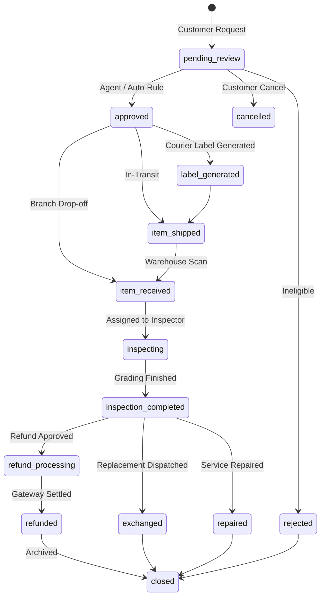

# RMA Lifecycle & State Machine Workflow

## State Machine
The RMA lifecycle is governed by an explicit state machine with transition constraints in `App\Models\Rma::canTransitionTo()`:

## Key Workflow Stages
1. **Initiation**: Customer submits an RMA via the Customer Self-Service Portal (`/portal`) or an agent initiates on `/admin`.
2. **Policy Evaluation**: `RmaEngineService::evaluateEligibility()` verifies return window expiry, product returnability, and remaining refundable balance.
3. **Auto-Approval**: If estimated amount is under threshold (e.g., $50) and customer has low fraud risk, the RMA is immediately auto-approved.
4. **Prepaid Shipping Label**: Courier shipping label and drop-off vouchers are dynamically generated using `imrandevbd/laravel-unicode-pdf`.
5. **Intake & Grading**: Warehouse scans barcode, runs diagnostic checklist, assigns Grade (A, B, C, Defective), and records seal conditions.
6. **Disposition**: Smart disposition routing directs items to restock shelves, refurbishment, or vendor return.
7. **Resolution**: Refund issued, replacement order generated, or repair job closed.
